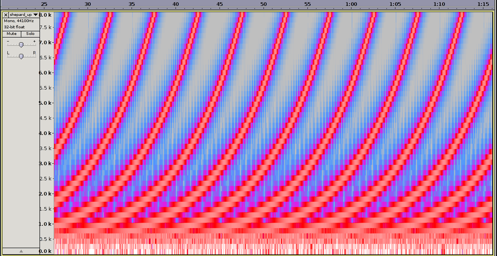

# Endless Tension: Shepard Tones and Adaptive Music in Games
### Jianghao Li

## Tension Building Without a Known Ending

Imagine a large-scale multiplayer shooting game. The two teams are having an extended standoff. Neither sides are able to advance their progress. The combat might end in just a few seconds, or it could last a couple of minutes.

This brings an interesting challenge for the sound designers to consider: how do you design sounds to express the growing tension without knowing exactly after how long the game is going to end?

It's easy in a predetermined structure. In film productions, for example, the sound designers and composers are given very specific and defined clips to work with, and they know clearly that at the moment of `01:23:34:533`, there will be an end to the scene. That is to say, traditional sound build-ups follow a given structure, and volume increases, rhythm accelerations, or pitch rises could be applied until the music reaches a climax.

In our interactive example, however, the progression of the game depends heavily on the players. It's highly possible that the music will reach climax before the game resolves, vice versa.

Luckily, there is a psychoacoustic approach to this problem: the use of **Shepard-Risset glissando**. It creates the illusion of endlessly continuously rising pitch, allowed to be controlled via game parameters.

Before we dive into more geeky technical stuff, let's discuss why rising pitches bring tension to the audience.

## The Pyschoacoustics of Rising Sound

### Acoustic Motion and Perceived Urgency

How sounds evolve provides information of the surrounding.

Neuhoff (1998) discovered that listeners tended to *overestimate* increases in sound levels compared with equivalent decreases. This helps to explain why in sound design, people tend to **increase loudness, rise pitch, and change spectral brightness**, in order to **reinforce the impressions of escalation**.

### Pitch, Arousal, and Musical Expression

Pitch plays an important role in communicating emotions along with tempo, volume, and timbre.

In game music, upward pitch evolvement tend to be used to build up emotional escalation. Some examples include: a rising synthesizer creating an impression of accumulating energy (laser guns); ascending string textures establishing unstable and tense atmospheres; rising pitch combined with accelerating tempo preparing for an resolving event.

Overall, a growing pitch appears to be developing into something significant.

### Expectation and Music Climax

Again, rising pitch comes with a sense of expectation. Continuous risers traditionally are used followed by significant events, such as an explosion, a musical drop, or some sort of resolution. 

In our multiplayer shooting game example, the final resolution of the standoff is the end of the game (or taking down a site). The riser played contributes to create a sense of expectation, but the game may or may not end at the moment when the riser reaches its climax. This is where we need to maintain this developing tension, while making sure it's responsive to an unpredictable series of events.

### Auditory Adaptation

A sustained sound can lead to auditory adaptation, which is a reduction in sensitivity to a constant stimulus. Even when such stimuli are "moving", if the rate of change or the overall tonal characteristics are almost constant, people get used to it, and those sounds will be perceptionally faded.

This is an important note for sound designers, that the behavior of a tension-building sound should respond to the evolving gameplay context.

This article will show how Shepard tones can be adapted to address this.

> References: Neuhoff (1998); Juslin & Laukka (2003); Huron (2006).

## The Shepard-Risset Illusion

### Why is Conventional Pitch Rising Not Enough?

A typical rising pitch can be described as

$$f(t) = f_0 \cdot 2^{rt}$$

where $f_0$ is the initial frequency, $r$ is the rate of octave increase, and $t$ is time. This is a simple exponential function that describes a pitch that rises continuously over time. As long as $r$ is positive, the pitch rises **exponentially**. 

However, per the **Nyquist-Shannon Sampling Theorem**, the highest frequency that can be represented in a digital audio system is half of the sampling rate.

$$f_{max} = \frac{f_s}{2}$$

This simple pitch rise will eventually reach the Nyquist frequency and become aliased. 

More practically speaking, the usable frequency range is typically limited by the desired timbre, overall mix, and hearing comfort.

Once the pitch reaches the upper bound, sound designers will have to stop it, hold it, or reset it, all of which break the perceived continuity.

An undetermined game length will thus benefit from a special sound structure that can maintain upward movement without reaching its audible limit.

### Shepard Tones and Circularly Structured Pitch

In 1964, Roger Shepard introduced a special type of sound that creates the illusion of endlessly rising pitch. The Shepard tone is constructed by layering several sine waves separated by octaves, and applying a specific amplitude envelope to each layer.

This arrangement creates ambiguity in absolute pitch height while preserving the perception of relative pitch movement.

When the same principle is extended to continuous pitch motion, it turns into a **Shepard–Risset glissando**.

### Endless Ascent

In a Shepard-Risset glissando, multiple oscillators play in parallel, each moving up in pitch at the same rate. Their amplitudes are controlled by an **envelope**, which fades the ocsillators out as they approaches the upper frequency boundary, and fades them back in at the lower one.

Because there are several oscillators playing simultaneously, the listener perceives a continuous rise in pitch, even though the actual frequencies are cycling back to lower octaves, without noticing a clear start or end point.



## Rendering Shepard Tones Sample by Sample

The reason we want to use a Shepard tone is that it can be generated in real-time, and its parameters can be adjusted dynamically based on the game state. Here we will discuss how to render it in a digital audio system.

### Multiple Oscillators

To begin with, we define a set of `N` sine wave oscillators, each separated by an octave. 

For a given oscillator `k`, its instaneuos frequency at any sample is given by:

$$f_k[n] = f_{min} \cdot 2^{(x_n[n])}$$

where `f_{min}` is the minimum frequency, `x_n[n]` represents the oscillator's position on a logarithmic frequency axis, and `n` is the sample index.

We use logarithmic notation because each octave represents a doubling of frequency.

### Spectral Envelope

As is discussed earlier, we need to apply an envelope to each oscillator to fade them in and out as they approach the upper and lower frequency bounds. We can use a Hann window together with a Gaussian envelope to control both the amplitude and the spectral centralization:

$$w_k[n] = \text{Hann}(x_k[n]) \cdot e^{-\frac{(x_k[n] - \mu)^2}{2\sigma^2}}$$

where `Hann` is the Hann window function, `μ` is the center frequency of the envelope, and `σ` controls the width of the Gaussian envelope.

### Phase Accumulation

Each oscillator will maintain its own phase because we need cross-block continuity in real-time audio rendering. 

$$\phi_k[n] = \text{frac}(\phi_k[n-1] + \frac{f_k[n]}{f_s})$$

Then we use this phase to generate the sine wave samples:

$y[n] = \sin{2\pi \phi_k[n]}$

With their own phase, we can change the frequency at per-sample resolution, and the Shepard tone will be able to respond to game events in real-time.

### Finally, Ouput!

We will output the **weighted sum** of all oscillators to produce the final Shepard tone:

$$y[n] = g[n] \cdot{\frac{\sum{w_k[n] \cdot \sin{2\pi \phi_k[n]}}}{\sqrt{\sum{w_k[n]^2}} + \epsilon}}$$

For each sample, we render it using this equation.

Here's a sample implementation in C++:

```cpp
// We assume we already have other member variables
// defined in the class.
float ShepardTone::processSample(float x_n)
{
    float output = 0.0f;
    float weightSquaredSum = 0.0f;

    // Every oscillator contributes to the final output
    for (Oscillator& osc : m_oscillators)
    {
        // Get the frequency and the weight of the current oscillator
        const float freq = m_fMin * std::pow(2.0f, x_n);
        const float weight = calculateWeight(x_n);

        // Get the output of the current oscillator
        const float sample = std::sin(2.0f * PI * osc.phase);

        output += weight * sample;
        weightSquaredSum += weight * weight;

        // Update the phase of the current oscillator
        osc.phase += freq / m_sampleRate;
        osc.phase -= std::floor(osc.phase); // Keep phase in [0, 1)

        // Update the frequency position of the current oscillator
        // riseRate is a local variable. It could be made
        // constant or be controlled by game parameters.
        osc.octave += riseRate / m_sampleRate;

        // Wrap the octave position to stay within the range of oscillators
        if (osc.octave > m_numOscillators)
        {
            osc.octave -= m_numOscillators;
        }
    }

    // Normalize the output by the sum of weights
    output /= std::sqrt(weightSquaredSum) + 1e-6f; // Avoid division by zero

    // Apply gain to the output
    // Gain is a local variable. It could be made constant or be controlled by game parameters.
    return gain * output;
}
```

The weight can be implemented as follows:

```cpp
float ShepardTone::calculateWeight(float x_n)
{
    // Calculate the weight based on the Hann window and Gaussian envelope
    const float hannWeight = 0.5f * (1.0f - std::cos(2.0f * PI * x_n / m_numOscillators)); // Hann window

    const float z = (x_n - m_centerFrequency) / m_sigma;
    const float gaussianWeight = std::exp(-0.5f * z * z);

    return hannWeight * gaussianWeight;
}
```

## Game-Driven Intensity

Developers of `Battlefield 6` explained that they used an intensity parameter to implement a dynamic auditory experience. And we can do the same thing!

We're able to make the tone respond to the gameplay by taking this real-time rendering approach. Let's assume the game provides us with a normalized intensity value `I`, where 

$$I \in [0, 1]$$

Our focus is the relationship between the intensity value and the resulting audio behavior.

### The Two Controlled Parameters

Remember in our code snippet, we have two parameters that can be controlled by the game: `riseRate` and `gain`. Those could be calculated based on `I`, although, we want to smooth the changes, because abrupt changes in real-time audio usually result in clicks or pops.

$$\text{riseRate} = \text{MaxRiseRate} \cdot \text{SmoothedI}$$
$$\text{gain} = \text{SmoothedGain}$$

Basically, with a higher intensity value, the Shepard tone will rise faster and be louder. We *can*, if we want, make the envelope width and center frequency also respond to the intensity value, but for simplicity, we will keep them constant in this example.

### Smoothed Intensity

Simply enough, a one-pole low-pass filter can be used to smooth the intensity value:

$$
\text{SmoothedI}[n] = \alpha \cdot \text{SmoothedI}[n-1] + (1 - \alpha) \cdot I[n]$$

where `α` is a smoothing factor between 0 and 1. A higher `α` results in slower response to changes in intensity.

A simple implementation in C++ could look like this:

```cpp
float ShepardTone::updateSmoothedIntensity(float I)
{
    const float safeI = std::clamp(I, 0.0f, 1.0f); // Ensure I is within [0, 1]
    const float smoothedIntensity = m_alpha * m_smoothedIntensity + (1.0f - m_alpha) * safeI;
    return smoothedIntensity;
}
```

And in our rendering function, we'll just update our member variable, and use it to calculate the respective `riseRate` and `gain`:

```cpp
float ShepardTone::processSample(float x_n)
{
    /* ... previous code ... */
    m_smoothedIntensity = updateSmoothedIntensity(m_intensity);
    const float riseRate = m_maxRiseRate * m_smoothedIntensity;
    const float gain = m_smoothedIntensity; // Or any other mapping you prefer
    /* ... rest of the code ... */
}
```

### Interactive Music Design

Usually, there are `2` ways of designing interactive music: **vertical layering** and **horizontal re-sequencing**.

`Vertical layering` is a technique where multiple instrumental layers are played simultaneously, each with different volume levels. The music director changes the volume of each layer based on paramters given by the game. This is often more versatile because sound designers can decide what music layers react to what game states.

`Horizontal re-sequencing` is a technique where the music is divided into segments, and the game engine decides which segment to play next based on the game state. This is often more straightforward to implement, but it can be less flexible in terms of musical expression.

In our Shepard tone example, we can use the Shepard tone as a layer in a vertical layering system. While other layers are pre-written and looped, the Shepard tone can be a procedurally generated audio input layer. It doesn't matter whether other layers change or not, the Shepard tone will always be able to respond to the game state in real-time.

## Live Demo

## DAW Rendering or Percedural Generation?

Shepard-Risset glissando can be generated in multiple ways.

1. **DAW Pre-Rendering**: stacking several octaves of a sound source and use automations to control the volume and rate of pitch rise. This is simple and is effective when you have a desired timbre and pre-designed sound.
2. **Middleware Implementation**: This is a "in-between" approach, where you can have a pre-rendered sound source, while also controling its parameters in real-time. This is often done in middleware like FMOD or Wwise.
3. **Procedural Generation**: Via a customized audio renderer, generate per sample in real time. This does not require any pre-designed sound source, and you can even control the very low-level DSP behaviors. Becuase it's decoupled from audio assets, this is the most flexible approach, but requires more technical knowledge and implementation effort.

Whichever approach you go with, the Shepard tone can be an effective psychoacoustic tool to build tension in a game situation where the exact duration is unkown. The real-time rendering approach introduced in this article provides a ground for more advanced sound design. It can be extented to incorporate more complex timbre ddesign.